# FileCompare (MacCompare & WinCompare)

<p align="center">
  <b>A modern, high-performance native file & directory comparison and merge suite for macOS & Windows 11.</b><br>
  <b>专为 macOS 与 Windows 11 双生态深度打造的高性能、现代原生文件与目录对比合并工具。</b><br>
  <b>macOS および Windows 11 向けに設計された高性能なネイティブ差分比較＆マージツール。</b>
</p>

<p align="center">
  <a href="#english">English</a> • <a href="#简体中文">简体中文</a> • <a href="#日本語">日本語</a>
</p>

<p align="center">
  
  
  
  
  
</p>

---

<a name="english"></a>
## English

> **FileCompare** is a modern, cross-platform native comparison suite consisting of **MacCompare** (macOS Native, SwiftUI / AppKit) and **WinCompare** (Windows 11 Native, WinUI 3 / Windows App SDK). Both clients share a high-throughput **Rust differential calculation core**, delivering sub-millisecond diff speeds and 100% algorithm parity.

### 🌟 Key Highlights & Ecosystem

| Platform | Native UI Stack | Architecture | Packaging & Distribution | CLI Utility |
| :--- | :--- | :--- | :--- | :--- |
| 🍏 **MacCompare** | SwiftUI + AppKit | Universal Binary 2 (`arm64` + `x86_64`) | `.dmg`, `.zip`, Homebrew Tap | `mcdiff` |
| 🪟 **WinCompare** | WinUI 3 + Fluent Design | Windows 11 / 10 (`x64` + `ARM64`) | Fluent Design Setup (`.exe`), Portable `.zip` | `wincmp` |
| ⚡ **Shared Core** | Rust 2024 Cargo Workspace | Native Static Library / DLL | Embedded FFI (`diff-core`, `excel-diff-core`, `fs-scanner`) | C-ABI / P-Invoke |

---

### 🌟 Core Features

- **🤖 Dual-Mode AI Assistant (Local Offline Gemma 3 & Cloud/Ollama API)**:
  - **100% On-Device Local AI**: Integrated Google Gemma 3 (1B-IT blazing fast & 4B-IT advanced) inference. Completely offline with zero code leaks.
  - **Cloud & LAN LLMs**: Preset adapters for DeepSeek, OpenAI, local/LAN Ollama (`qwen2.5-coder`, `llama3.2`), with 1-click connectivity and latency testing.
  - **Smart Change Intent Summary**: Automatically distills the overarching purpose of paired diffs into a concise one-line summary and structured key modification bullet points.
  - **Automated Conventional Commits**: Generates standardized Git commit messages (`feat(core): ...`, `fix(ui): ...`) with 1-click clipboard copy.
- **⚡ High-Throughput Rust Core & Dual-Engine Architecture**:
  - **Myers & Token LCS Diff (`diff-core`)**: Sub-millisecond text diffing and 3-way merge conflict resolution.
  - **Big-Data Spreadsheet Engine (`excel-diff-core`)**: Memory-mapped zero-copy parsing via `calamine` and `memmap2`, 64-bit row hash fingerprinting with `ahash`, and Viewport Paging maintaining a tiny 30~60MB memory footprint on million-row tables.
  - **Concurrent Directory Scanner (`fs-scanner`)**: Multi-threaded parallel file traversal powered by `rayon` and hardware-accelerated `crc32fast`.
- **📊 Excel & Spreadsheet Structured Comparison (.xlsx / .xlsb / .xls / .csv / .tsv)**:
  - Multi-sheet switching with diff-status badges, pixel-perfect synchronized grid scrolling, primary key Hash Join alignment, cell-level & inline character diff highlights, and configurable numeric floating-point tolerance (`|v1 - v2| <= tolerance`).
- **📄 Structured Word Document Comparison (.docx / .doc)**:
  - High-fidelity paragraph styling diff (font weight, italics, underline, size, color), native embedded table cell diffs, multimedia SHA-256 fingerprinting, and H1~H6 heading outline navigation.
- **📑 Cross-Platform PDF Structured & Pixel Visual Diff (PixelDiff)**:
  - Zero-dependency stream parser with FlateDecode, ToUnicode CMap mapping, and baseline clustering.
  - Dual diff modes: high-precision token text diff and pixel visual difference detection with mask overlays.
  - Flexible viewing options: side-by-side vs. overlay blend modes with opacity adjustment and synchronized dual scrolling.
  - Auto-detection format prompting and 1-click standalone offline HTML inspection report generation.
- **✍️ In-Place Text Editing & Stable Minimap Viewport**:
  - Direct in-place editing inside diff editors across macOS and Windows (Enter splits lines, Backspace merges lines).
  - 250ms asynchronous debounced diff recalculation with fine-grained collection synchronization to prevent typing latency.
  - Rock-solid minimap viewport tracking, eliminating jitter loops on resize and drag operations.
- **📁 Blazing-Fast Folder Diff & Hierarchical Tree**:
  - Visual depth indentation, smooth rotating chevron animations, and 1-click Expand/Collapse All toolbar actions.
  - In-place collection updates and persistent vertical scroll offset across filter reapplications.
  - Timestamp/size quick checks, CRC32 hash verification, and rule-based bidirectional synchronization with safe Dry-Run previews.
- **🔀 Git 3-Way Conflict Merge**:
  - Visual 3-way conflict resolution across Local vs. Base vs. Remote, intelligent auto-merging of non-conflicting sections, and 1-click conflict resolution.
- **🏠 Welcome Launcher Dashboard & Persistent History**:
  - 2x2 Launch Grid (Text, Excel, Word, Folder), persistent session history, independent drag-and-drop zones, and rapid tab switching.
- **⌨️ Terminal CLI & Git Integration**:
  - Built-in `mcdiff` (macOS) and `wincmp` (Windows), out of the box for `git difftool` and `git mergetool`.
- **📦 Native Packaging & In-App Auto-Update**:
  - **macOS**: Drag-and-drop `.dmg`, portable `.zip`, and official Homebrew Tap (`brew install andychao217/tap/maccompare`).
  - **Windows**: Modern WPF-UI Fluent Design single-file installer (`WinCompare-Setup.exe`) featuring in-place upgrade detection, dynamic accent/theme sync, dual-entry maintenance (`Setup.exe` + `Uninstall.exe`), and full unattended command-line mode (`--silent`, `/S`, `--dir`).
  - **In-App Updater**: Cross-platform auto-update flow with multi-language release notes auto-sensing.

---

### 📸 Screenshots & UI Preview

#### 1. Windows 11 Native Edition (WinUI 3 & Fluent Design)

| Welcome Hub | Fine-Grained Text Diff & AI Summary | Excel Spreadsheet Diff |
| :---: | :---: | :---: |
| 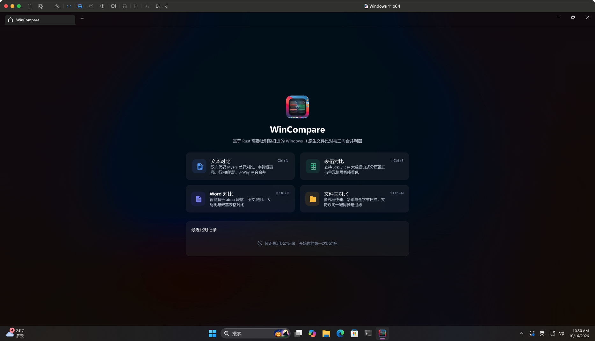 | 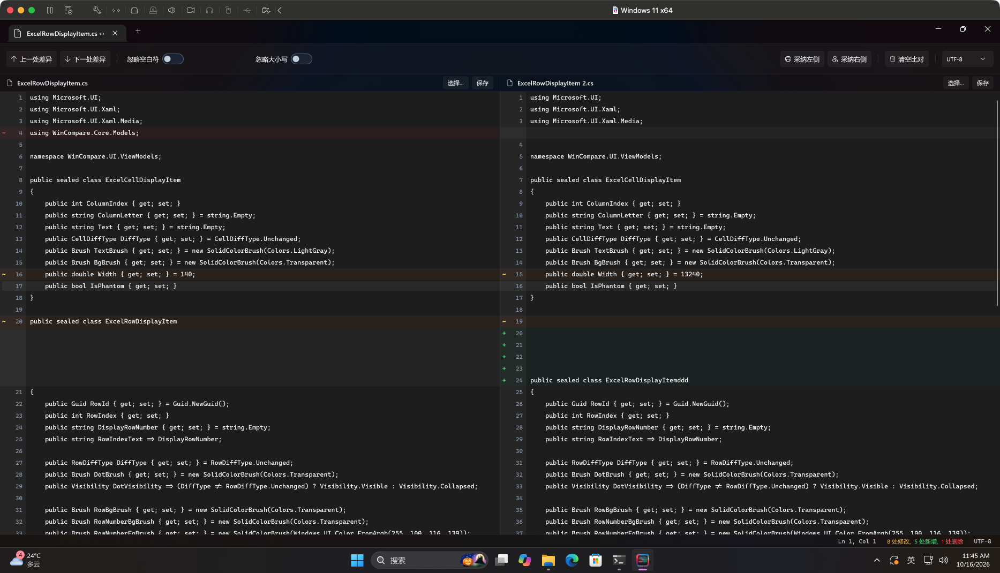 | 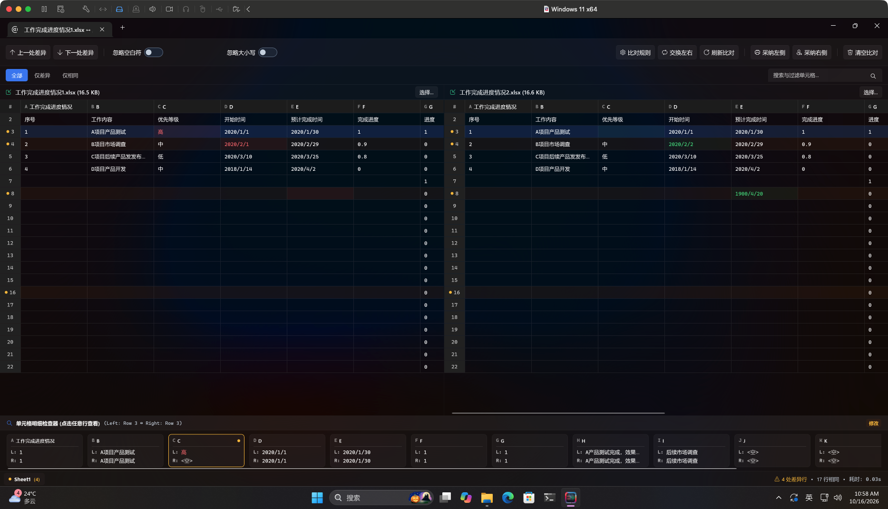 |

| Word Document Diff | Git 3-Way Conflict Merge | Folder Fast Diff & Sync |
| :---: | :---: | :---: |
| 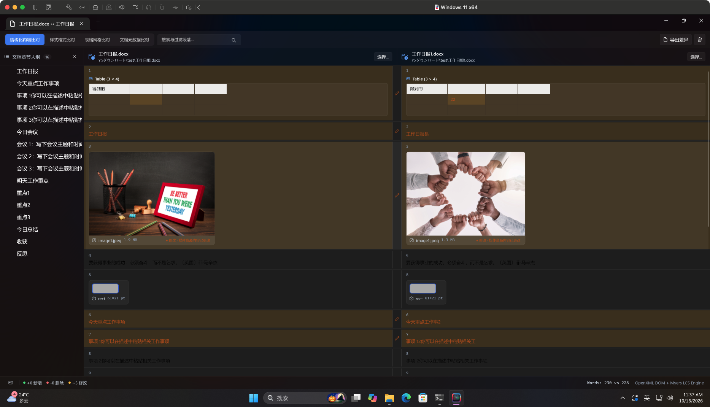 | 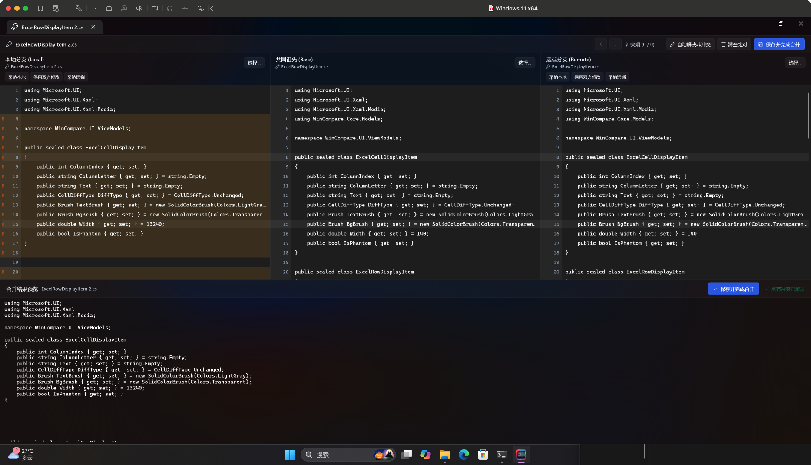 | 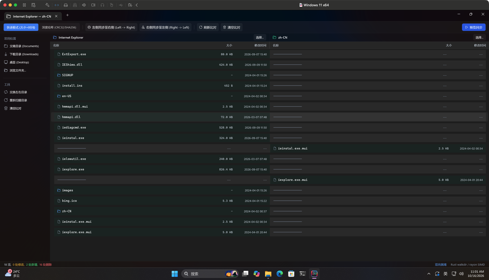 |

| PDF Visual Diff (Dark Theme) | PDF Visual Diff (Light Theme) |
| :---: | :---: |
|  | 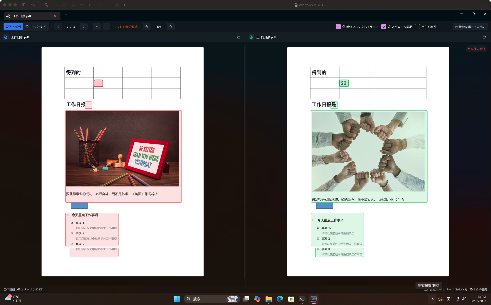 |

#### 2. macOS Native Edition (SwiftUI & AppKit)

| Welcome Hub | Text Diff with AI Summary | Excel Structured Diff |
| :---: | :---: | :---: |
| 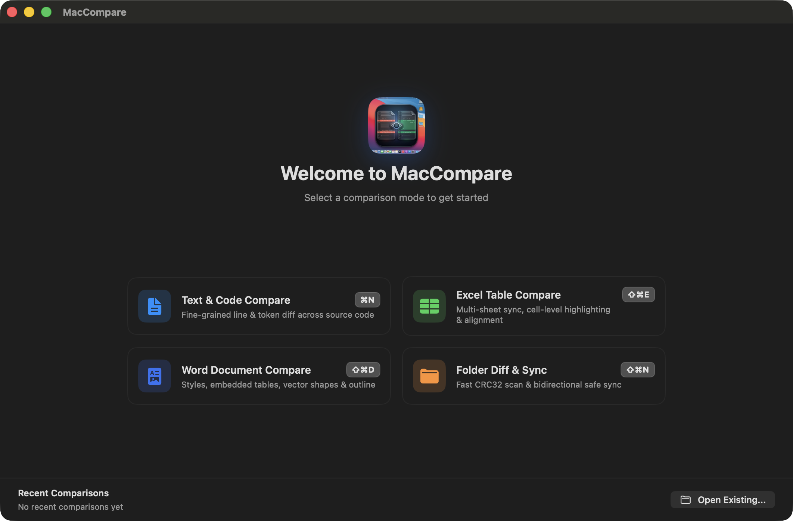 | 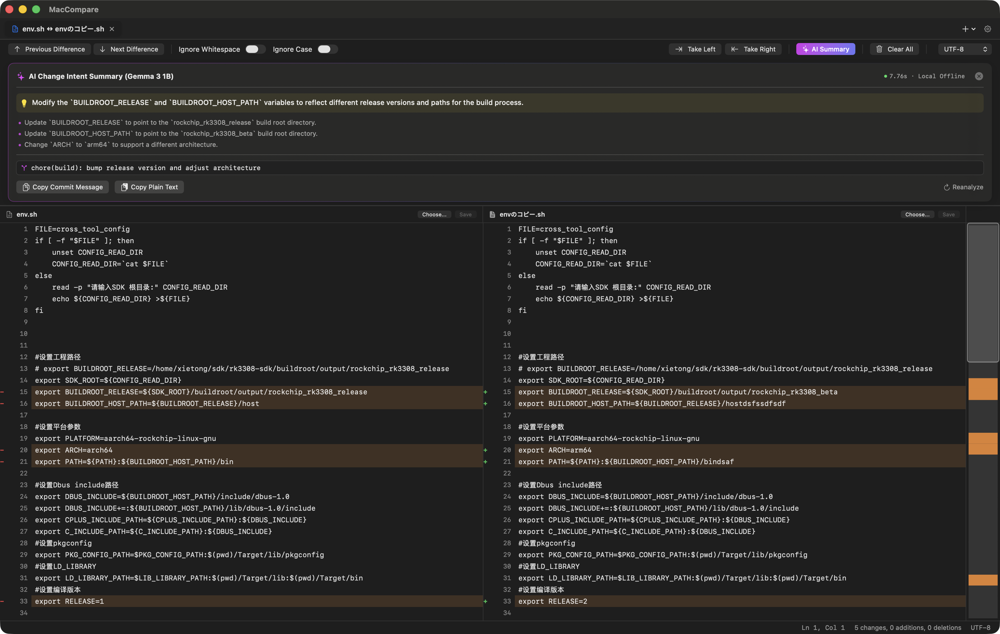 | 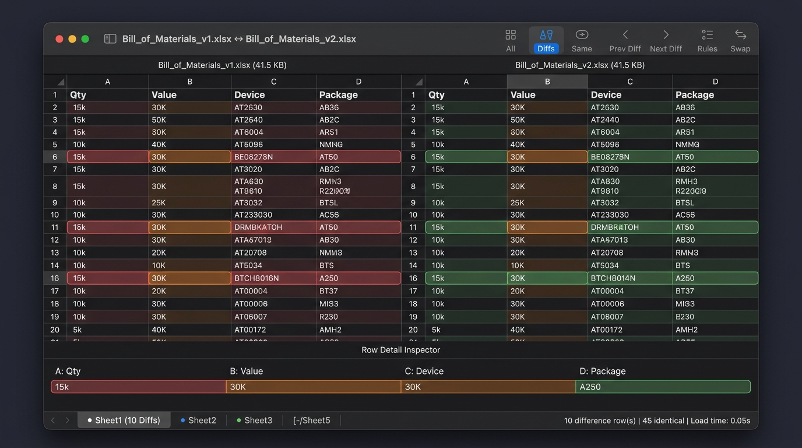 |

| Word Document Diff | Git 3-Way Conflict Merge | Folder Fast Diff & Sync |
| :---: | :---: | :---: |
|  | 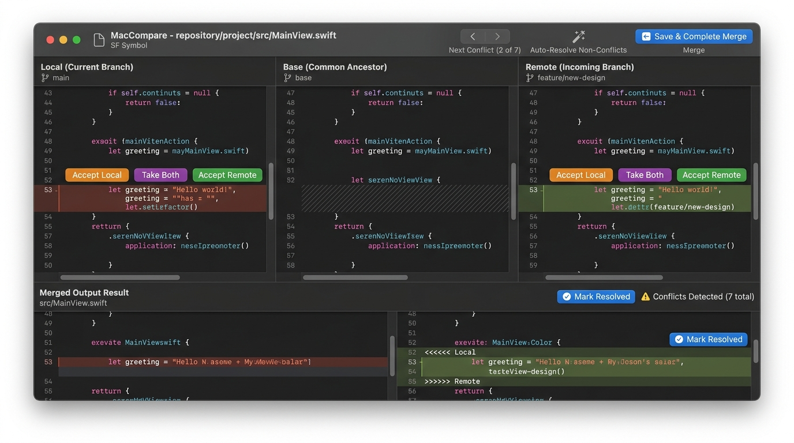 | 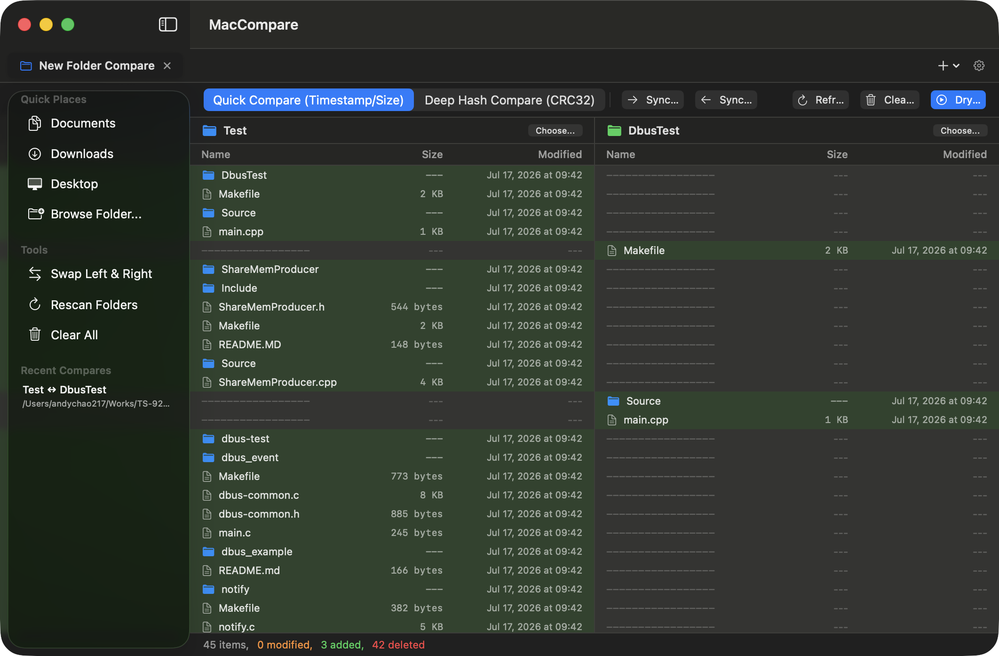 |

| PDF Visual Diff (Dark Theme) | PDF Visual Diff (Light Theme) |
| :---: | :---: |
| 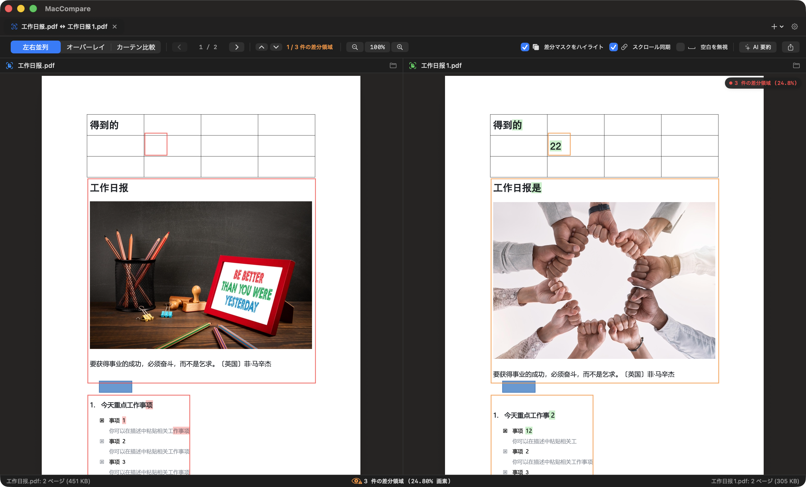 |  |

---

### 📁 Project Structure

```text
FileCompare/
├── core/                             # High-performance Rust core engine (Cargo Workspace)
│   ├── crates/diff-core/             # Myers Diff algorithm, token LCS & 3-Way Merge
│   ├── crates/fs-scanner/            # Parallel directory scanner (rayon) & CRC32 hash
│   ├── crates/excel-diff-core/       # Big-data spreadsheet engine (calamine, memmap2, ahash)
│   ├── crates/syntax-highlighter/    # Tree-sitter incremental syntax highlighting interface
│   └── crates/maccompare-ffi/        # Cross-language C-ABI export layer (dynamic & static library)
│
├── macos/                            # macOS native application (Swift 6 / SPM)
│   ├── Package.swift                 # SPM modular configuration
│   ├── Sources/
│   │   ├── CMacCompareCore/          # C-bridge modulemap & headers linking Rust static library
│   │   ├── MacCompareKit/            # Core models, ViewModels, Dual-Engine dispatcher & UI
│   │   ├── MacCompare/               # macOS main application & AppCommands
│   │   └── mcdiff/                   # Terminal CLI comparison tool
│   └── Tests/MacCompareTests/        # Unit test suite (Swift + Rust FFI integration)
│
├── win/                              # Windows 11 native application (.NET 10 / WinUI 3)
│   ├── WinCompare.sln                # Visual Studio 2022/2026 Solution
│   ├── scripts/                      # Windows PowerShell & Batch build scripts
│   │   ├── package_win.ps1           # 1-Click packaging (Portable ZIP + Fluent Setup Installer)
│   │   ├── build_rust_core.ps1       # Compile Rust maccompare_ffi.dll
│   │   └── run_local.ps1             # Local incremental runner (prevents VM shared disk crash)
│   └── src/
│       ├── WinCompare.Core/          # C# Core libraries (P/Invoke, DiffService, Excel, Word, PDF, AI)
│       ├── WinCompare.UI/            # WinUI 3 Native Fluent Design GUI
│       ├── WinCompare.Cli/           # Terminal CLI comparison tool (wincmp.exe)
│       └── WinCompare.Setup/         # Modern WPF-UI Fluent Design single-file installer & uninstaller
│
├── docs/                             # Official website & documentation (GitHub Pages)
└── scripts/                          # macOS build and packaging automation scripts
```

---

### 🚀 Quick Start

#### macOS Installation
- **Homebrew (Recommended)**:
  ```bash
  brew install andychao217/tap/maccompare
  ```
- **Direct Download**: Download `MacCompare-<version>.dmg` or `MacCompare-<version>-macos.zip` from [GitHub Releases](https://github.com/andychao217/FileCompare/releases/latest).

#### Windows Installation
- **Fluent Setup Installer (Recommended)**: Download `WinCompare-<version>-Setup-x64.exe` from [GitHub Releases](https://github.com/andychao217/FileCompare/releases/latest) for an elegant Fluent Design setup wizard with desktop/start menu shortcuts and terminal integration. Supports silent deployment via `Setup.exe --silent` (or `/S`).
- **Portable ZIP**: Download `WinCompare-<version>-windows-x64.zip` (self-contained, unpack & run).

#### Git Diff & Merge Configuration

- **macOS (`mcdiff`)**:
  ```bash
  git config --global diff.tool maccompare
  git config --global difftool.maccompare.cmd 'mcdiff "$LOCAL" "$REMOTE"'
  git config --global merge.tool maccompare
  git config --global mergetool.maccompare.cmd 'mcdiff "$LOCAL" "$REMOTE" -b "$BASE" -m "$MERGED"'
  ```
- **Windows (`wincmp`)**:
  ```cmd
  git config --global diff.tool wincmp
  git config --global difftool.wincmp.cmd "wincmp diff "$LOCAL" "$REMOTE""
  git config --global merge.tool wincmp
  git config --global mergetool.wincmp.cmd "wincmp merge "$LOCAL" "$BASE" "$REMOTE" "$MERGED""
  ```

#### Packaging Builds Locally

- **macOS Universal DMG**:
  ```bash
  bash scripts/package_dmg.sh 0.7.0
  ```
- **Windows Fluent Setup & ZIP**:
  ```powershell
  .\win\scripts\package_win.ps1 -Version 0.7.0
  ```

---

<a name="简体中文"></a>
## 简体中文

> **FileCompare** 是专为 **macOS** 与 **Windows 11** 双生态深度打造的高性能、现代原生文件与目录对比合并套件。由 macOS 原生版 **MacCompare**（SwiftUI / AppKit）与 Windows 11 原生版 **WinCompare**（WinUI 3 / Windows App SDK）组成。双端均搭载同一套由 **Rust 2024** 编写的高吞吐差分计算核心，实现毫秒级比对性能与算法的 100% 对齐。

### 🌟 双端原生技术栈全景

| 平台客户端 | 原生界面框架 | 运行架构支持 | 打包分发形态 | 命令行工具 |
| :--- | :--- | :--- | :--- | :--- |
| 🍏 **MacCompare** | SwiftUI + AppKit 原生深度适配 | Universal Binary 2（Apple Silicon + Intel） | DMG 镜像、免安装 Zip、Homebrew Tap | `mcdiff` |
| 🪟 **WinCompare** | WinUI 3 + Fluent Design 云母设计 | Windows 11 / 10（`x64` + `ARM64`） | Fluent Design 单文件安装器 (Setup.exe)、绿色免安装 Zip | `wincmp` |
| ⚡ **底座共享核心** | Rust 2024 高吞吐 Cargo Workspace | 原生静态库 / 动态库 DLL | 跨语言 FFI 零拷贝调度 | C-ABI / P-Invoke |

---

### 🌟 核心功能全览

- **🤖 端侧离线与云端双模 AI 智能助手**：
  - **100% 端侧离线大模型**：集成 Google Gemma 3（1B 极速版与 4B 进阶版）端侧离线推理，断网完全可用，数据 100% 留存本地；
  - **云端与局域网大模型兼容**：预设适配 DeepSeek、OpenAI、本地/局域网 Ollama（如 `qwen2.5-coder`、`llama3.2`）与自定义端点，提供一键延迟与连通性测试；
  - **变更意图智能总结**：自动分析成对差异，秒级输出「一句话修改目的」与精准匹配变量名的「核心变更要点清单」；
  - **规范化 Commit 提交信息生成**：一键生成标准 Git Conventional Commit 提交描述并自动复制到剪贴板。
- **⚡ Rust 高性能核心与双引擎架构**：
  - **Myers 与 Token LCS 差分 (`diff-core`)**：毫秒级完成行级差分、内联字符差异与 Git 三向冲突合并；
  - **海量表格大数据引擎 (`excel-diff-core`)**：集成 `calamine` 与 `memmap2` 零拷贝内存映射，利用 `ahash` 64位行哈希秒级跳过无差异行，FFI 视口分页让百万行表格前端内存稳定在 30~60MB；
  - **多线程并发目录扫描 (`fs-scanner`)**：基于 `rayon` 与硬件加速 `crc32fast` 实现超高速文件夹对比与深度指纹校验。
- **📊 Excel 与表格文件结构化全要素比对 (.xlsx / .xlsb / .xls / .csv / .tsv)**：
  - 多工作表自动提取与切换、像素级双向同步表格网格、主键列 Hash Join 极速对齐与浮点容差过滤 (`|v1 - v2| <= tolerance`)。
- **📄 Word 文档结构化全要素比对 (.docx / .doc)**：
  - 正文段落富文本样式流（字号、粗体、斜体、下划线、颜色）、内嵌表格网格单元格级追踪、多媒体附件 SHA-256 指纹比对与标题大纲快速导航。
- **📑 跨平台 PDF 结构化与像素级视觉比对 (PixelDiff)**：
  - 原生零依赖流式解析 FlateDecode 解压、ToUnicode CMap 字符映射与按 Y 坐标行基线聚类；
  - 双模比对引擎：高精度 Token 文本差分与像素级视觉比对差异遮罩蒙版 (Mask Overlay)；
  - 并排对比 (Side-by-Side) 与透视叠加 (Overlay) 双模式切换，支持透明度滑块与双向像素同步滚动；
  - PDF 格式智能感知提示，一键导出双端一致的独立离线自包含 HTML 审查报告。
- **✍️ 文本原位即时编辑与防抖稳定化**：
  - 差分编辑区内直接就地编辑（回车智能拆分新行，退格智能合并前行）；
  - 250ms 防抖差分异步重算与原位集合同步，彻底消除键入卡顿；
  - Minimap 缩略图视口稳定化算法，根除缩放与拖拽过程中的抖动反馈循环；
  - 支持完整剪贴板快捷键（Ctrl+C/V/X/A），抑制拼写检查波浪线，提供纯粹的代码编辑器体验。
- **📁 文件夹树形层级展开/折叠与持久滚动**：
  - 真实树深度缩进与平滑旋转 Chevron 展开/折叠图标，支持工具栏一键全部展开/折叠；
  - Windows 原位集合项变更杜绝整表刷新引起的跳动与白屏；
  - 规则重新过滤时精确保留 `ScrollViewer` 垂直滚动位移，体验丝滑流畅；
  - 时间戳/大小快速检查与深度 CRC32 哈希对比，规则化双向同步并提供演练预览 (Dry-Run) 安全机制。
- **🔀 Git 三向冲突合并 (3-Way Merge)**：
  - 直观对比 Local vs Base vs Remote 冲突，智能自动解决非冲突部分，一键解决冲突。
- **🏠 启动欢迎主页与会话历史**：
  - 2x2 黄金对称模式导航、全局最近比对记录 (Recent Comparisons)、左右独立分栏 Drop Zone 预览与多标签快速循环切换。
- **⌨️ 终端开发者生态与 Git 深度整合**：
  - 内置 `mcdiff` (macOS) 与 `wincmp` (Windows)，开箱即用无缝对接 `git difftool` 与 `git mergetool`。
- **📦 双端标准化打包与在线更新**：
  - **macOS**：DMG 镜像、免安装 Zip 与 Homebrew 专属源 (`brew install andychao217/tap/maccompare`)；
  - **Windows**：基于 WPF-UI 的全新 Fluent Design 单文件安装器 (`WinCompare-Setup.exe`)，支持原位升级自动探测、强调色与深浅模式跟随、以及企业级静默命令行安装 (`--silent`, `/S`, `--dir`)；
  - **在线更新**：智能多语言 Release Notes 感知与各平台独立发布包的一键精准下载。

---

### 📸 软件实机界面预览 (UI Preview)

#### 1. Windows 11 原生版 (WinUI 3 & Fluent 设计)

| 启动主页 | 文本比对与 AI 总结 | Excel 表格结构化对比 |
| :---: | :---: | :---: |
|  |  |  |

| Word 文档对比 | Git 三向冲突合并 | 文件夹秒级比对与同步 |
| :---: | :---: | :---: |
|  |  |  |

| PDF 差分视觉对比 (深色外观) | PDF 差分视觉对比 (浅色外观) |
| :---: | :---: |
|  |  |

#### 2. macOS 原生版 (SwiftUI & AppKit 原生质感)

| 启动主页 | 文本比对与 AI 总结 | Excel 表格结构化对比 |
| :---: | :---: | :---: |
|  |  |  |

| Word 文档对比 | Git 三向冲突合并 | 文件夹秒级比对与同步 |
| :---: | :---: | :---: |
|  |  |  |

| PDF 差分视觉对比 (深色外观) | PDF 差分视觉对比 (浅色外观) |
| :---: | :---: |
|  |  |

---

### 🚀 快速上手

#### macOS 安装方式
- **通过 Homebrew 一键安装（推荐）**：
  ```bash
  brew install andychao217/tap/maccompare
  ```
- **下载 DMG 安装包**：从 [GitHub Releases](https://github.com/andychao217/FileCompare/releases/latest) 下载 `MacCompare-<version>.dmg`。

#### Windows 安装方式
- **Fluent 单文件安装器（推荐）**：从 [GitHub Releases](https://github.com/andychao217/FileCompare/releases/latest) 下载 `WinCompare-<version>-Setup-x64.exe`，双击开启 Windows 11 Fluent 现代向导，桌面与开始菜单自动生成快捷方式，终端可直接使用 `wincmp` 命令。支持企业与包管理器静默安装：`Setup.exe --silent`。
- **绿色免安装包**：下载 `WinCompare-<version>-windows-x64.zip`，解压即用。

#### 配置为 Git 默认比对与合并工具

- **macOS 配置**：
  ```bash
  git config --global diff.tool maccompare
  git config --global difftool.maccompare.cmd 'mcdiff "$LOCAL" "$REMOTE"'
  git config --global merge.tool maccompare
  git config --global mergetool.maccompare.cmd 'mcdiff "$LOCAL" "$REMOTE" -b "$BASE" -m "$MERGED"'
  ```

- **Windows 配置**：
  ```cmd
  git config --global diff.tool wincmp
  git config --global difftool.wincmp.cmd "wincmp diff "$LOCAL" "$REMOTE""
  git config --global merge.tool wincmp
  git config --global mergetool.wincmp.cmd "wincmp merge "$LOCAL" "$BASE" "$REMOTE" "$MERGED""
  ```

#### 本地一键打包

- **macOS (生成 Universal DMG)**：
  ```bash
  bash scripts/package_dmg.sh 0.7.0
  ```
- **Windows (生成 Fluent Setup 与便携 ZIP)**：
  ```powershell
  .\win\scripts\package_win.ps1 -Version 0.7.0
  ```

---

### 📄 开源许可证

本项目基于 [MIT License](LICENSE) 许可证开源。

---

<a name="日本語"></a>
## 日本語

> **FileCompare** は、**macOS** と **Windows 11** の両エコシステム向けに純正ネイティブ設計された、現代的で高性能なファイル＆ディレクトリ差分比較・マージツールスイートです。macOS ネイティブ版 **MacCompare**（SwiftUI / AppKit）と Windows 11 ネイティブ版 **WinCompare**（WinUI 3 / Windows App SDK）で構成されています。両クライアントは **Rust 2024** で書かれた共通の高スループット差分計算コアを搭載し、ミリ秒級の比較速度とアルゴリズムの 100% 完全な整合性を実現しています。

### 🌟 両端ネイティブ技術スタック全景

| プラットフォーム | ネイティブ UI | アーキテクチャ | パッケージ＆配布形態 | CLI ツール |
| :--- | :--- | :--- | :--- | :--- |
| 🍏 **MacCompare** | SwiftUI + AppKit ネイティブ最適化 | Universal Binary 2（Apple Silicon + Intel） | DMG イメージ、ZIP ポータブル版、Homebrew Tap | `mcdiff` |
| 🪟 **WinCompare** | WinUI 3 + Fluent Design マイカ外観 | Windows 11 / 10（`x64` + `ARM64`） | Fluent Design 単一インストーラー (Setup.exe)、ZIP 便携版 | `wincmp` |
| ⚡ **共通コア** | Rust 2024 高スループット Workspace | ネイティブ静的ライブラリ / DLL | ゼロコピー C-ABI FFI 呼び出し | C-ABI / P-Invoke |

---

### 🌟 主な機能一覧

- **🤖 オンデバイス・クラウド双模 AI アシスタント**：
  - **100% オンデバイス推論**：Google Gemma 3（1B 高速版 & 4B 高精度版）を統合し、完全オフラインでコード外部流出ゼロの安全なプライベート推論を実行可能。
  - **クラウド＆ローカル Ollama 連携**：DeepSeek、OpenAI、ローカル/LAN Ollama（`qwen2.5-coder`、`llama3.2` など）のアダプターを標準搭載し、ワンクリックで接続テストと遅延測定が可能。
  - **変更意図の自動要約**：ペア差分を解析し、「一行の修正目的」と変数名・変更内容を整理した「要点リスト」を即座に生成。
  - **規約準拠の Commit メッセージ自動生成**：Conventional Commits 形式（`feat(core): ...`, `fix(ui): ...`）のコミットメッセージを自動生成し、ワンクリックでクリップボードにコピー。
- **⚡ Rust 高速コア＆デュアルエンジンアーキテクチャ**：
  - **Myers & Token LCS アルゴリズム (`diff-core`)**：行単位差分、インライン文字ハイライト、Git 3方向マージ競合解決をミリ秒級で高速処理。
  - **大規模スプレッドシートエンジン (`excel-diff-core`)**：`calamine` と `memmap2` によるゼロコピーメモリマッピング、`ahash` 64ビット行ハッシュによる差分なし行の瞬間スキップ、視口ストリーミングページング（メモリ消費 30〜60MB 程度）。
  - **マルチスレッド並列ディレクトリスキャン (`fs-scanner`)**：`rayon` 並列イテレータとハードウェア加速 `crc32fast` による超高速フォルダ比較・同期。
- **📊 Excel・スプレッドシート構造化比較 (.xlsx / .xlsb / .xls / .csv / .tsv)**：
  - 複数シートのタブ切り替え、ピクセル同期スクロール、主キー列 Hash Join 照合、セル内文字単位差分ハイライト、数値浮動小数点許容誤差フィルタ (`|v1 - v2| <= tolerance`)。
- **📄 Word 文書構造化全要素比較 (.docx / .doc)**：
  - 段落リッチテキスト書式（文字サイズ、太字、斜体、下線、文字色）、埋め込み表グリッドのセル単位差分追跡、メディア添付ファイルの SHA-256 指紋比較、見出し（H1〜H6）アウトラインナビゲーション。
- **📑 クロスプラットフォーム PDF 構造化＆ピクセル視覚差分 (PixelDiff)**：
  - ゼロ依存の FlateDecode、ToUnicode 解析とベースライン行クラスタリングによる高精度テキスト解析。
  - トークン単位のテキスト差分と、差分マスクレイヤー（Mask Overlay）によるピクセル視覚比較。
  - 並列表示（Side-by-Side）および重畳透過表示（Overlay、不透明度スライダー・同期スクロール付き）。
  - PDF フォーマット自動判別アラートと、ワンクリックでの単体 HTML 検査レポート出力。
- **✍️ テキストインプレース直接編集＆防振ミニマップ**：
  - 差分エディタ上で直接編集が可能（Enter で改行分割、Backspace で前行統合）。
  - 250ms 非同期デバウンス差分再計算と細粒度コレクション更新で、タイピング遅延を解消。
  - リサイズやドラッグ時のジッター（小刻みな振動ループ）を完全解消した防振ミニマップ。
- **📁 フォルダ階層ツリー展開・折りたたみ＆スクロール位置保持**：
  - 階層インデントと回転アニメーション付き Chevron アイコン、ツールバーの一括展開／折りたたみ。
  - Windows で細粒度 `ObservableCollection` 原位更新を採用してちらつきを防止し、フィルタ再適用時も縦スクロール位置を正確に維持。
  - タイムスタンプ/サイズ高速チェックと詳細 CRC32 ハッシュ比較、Dry-Run プレビュー確認による安全な双方向同期。
- **🔀 Git 3方向競合マージ (3-Way Merge)**：
  - Local vs Base vs Remote の 3 カラム表示、非競合箇所の自動統合、ワンクリック競合解決。
- **🏠 ウェルカムホーム＆履歴管理**：
  - 2x2 黄金比ランチャー、最近の比較履歴の一括復元、左右独立ドラッグ＆ドロップゾーン、タブの高速巡回切り替え。
- **⌨️ ターミナル開発者エコシステム＆Git 統合**：
  - `mcdiff` (macOS) および `wincmp` (Windows) を内蔵し、`git difftool` / `git mergetool` として即座に利用可能。
- **📦 純正パッケージング＆自動更新**：
  - **macOS**：DMG イメージ、ZIP、Homebrew Tap (`brew install andychao217/tap/maccompare`)。
  - **Windows**：WPF-UI を採用した最新の Windows 11 Fluent Design 単一インストーラー (`WinCompare-Setup.exe`)。上書き更新自動検出、システムアクセントカラー連動、企業向け無人サイレントインストール (`--silent`, `/S`, `--dir`) を完備。
  - **アプリ内自動更新**：多言語リリースノート自動判別と各プラットフォーム向けの即時ダウンロード更新。

---

### 📸 ソフトウェア画面プレビュー (UI Preview)

#### 1. Windows 11 ネイティブ版 (WinUI 3 & Fluent デザイン)

| ホーム | テキスト比較＆AI 要約 | Excel スプレッドシート比較 |
| :---: | :---: | :---: |
|  |  |  |

| Word 文書比較 | Git 3方向マージ | フォルダ高速比較＆同期 |
| :---: | :---: | :---: |
|  |  |  |

| PDF 視覚差分比較 (ダークテーマ) | PDF 視覚差分比較 (ライトテーマ) |
| :---: | :---: |
|  |  |

#### 2. macOS ネイティブ版 (SwiftUI & AppKit)

| ホーム | テキスト比較＆AI 要約 | Excel スプレッドシート比較 |
| :---: | :---: | :---: |
|  |  |  |

| Word 文書比較 | Git 3方向マージ | フォルダ高速比較＆同期 |
| :---: | :---: | :---: |
|  |  |  |

| PDF 視覚差分比較 (ダークテーマ) | PDF 視覚差分比較 (ライトテーマ) |
| :---: | :---: |
|  |  |

---

### 🚀 クイックスタート

#### macOS のインストール
- **Homebrew 経由（推奨）**:
  ```bash
  brew install andychao217/tap/maccompare
  ```
- **DMG ダウンロード**: [GitHub Releases](https://github.com/andychao217/FileCompare/releases/latest) から `MacCompare-<version>.dmg` をダウンロード。

#### Windows のインストール
- **Fluent 単一インストーラー（推奨）**: [GitHub Releases](https://github.com/andychao217/FileCompare/releases/latest) から `WinCompare-<version>-Setup-x64.exe` をダウンロードしてウィザード実行。デスクトップ・スタートメニューにショートカットが生成され、ターミナルから `wincmp` が使用可能になります。無人サイレントインストールに対応：`Setup.exe --silent`。
- **ポータブル版 ZIP**: `WinCompare-<version>-windows-x64.zip` を展開してそのまま実行。

#### Git 差分・マージツールの設定

- **macOS 設定**:
  ```bash
  git config --global diff.tool maccompare
  git config --global difftool.maccompare.cmd 'mcdiff "$LOCAL" "$REMOTE"'
  git config --global merge.tool maccompare
  git config --global mergetool.maccompare.cmd 'mcdiff "$LOCAL" "$REMOTE" -b "$BASE" -m "$MERGED"'
  ```

- **Windows 設定**:
  ```cmd
  git config --global diff.tool wincmp
  git config --global difftool.wincmp.cmd "wincmp diff "$LOCAL" "$REMOTE""
  git config --global merge.tool wincmp
  git config --global mergetool.wincmp.cmd "wincmp merge "$LOCAL" "$BASE" "$REMOTE" "$MERGED""
  ```

#### ローカルでの一括パッケージング

- **macOS (Universal DMG 生成)**:
  ```bash
  bash scripts/package_dmg.sh 0.7.0
  ```
- **Windows (Fluent Setup & ZIP 生成)**:
  ```powershell
  .\win\scripts\package_win.ps1 -Version 0.7.0
  ```

---

### 📄 ライセンス

本プロジェクトは [MIT License](LICENSE) のもとでオープンソースとして公開されています。
